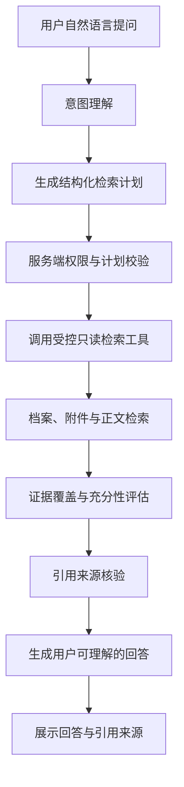
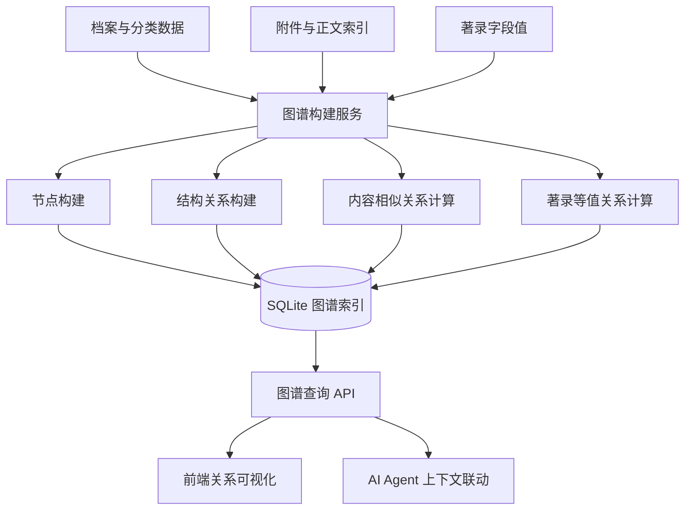
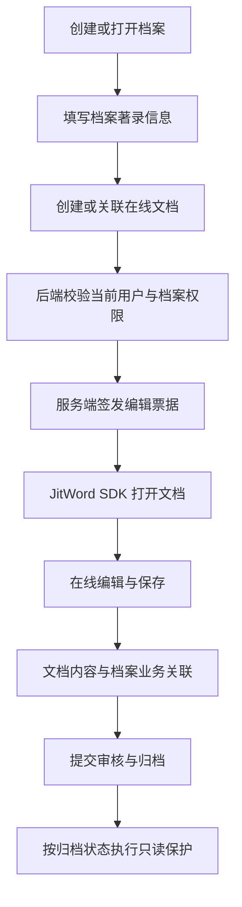
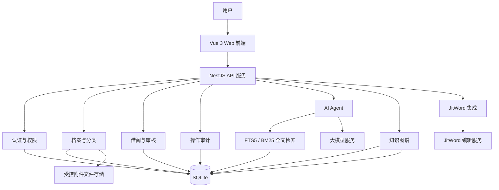

<div align="center">
  

  <h1>JitArchives</h1>
  <h3>智能电子档案管理系统</h3>

  <p><strong>让档案不止于存储，更成为可理解、可关联、可利用的知识资产。</strong></p>
  <p>AI Agent · Knowledge Graph · JitWord Online Document Editing</p>

  <p>
    <a href="https://github.com/jitOffice/jitarchives"><strong>GitHub 开源仓库</strong></a>
    ·
    <a href="https://archive.jitword.com">产品体验</a>
    ·
    <a href="https://inner.jitword.com/">JitWord</a>
  </p>

  <p>
    
    
    
    
    
    
  </p>
</div>

---

## 项目简介

**JitArchives** 是一款面向组织与企业的智能电子档案管理系统。它以档案全生命周期管理为基础，将 **AI Agent、知识图谱和 JitWord 在线文档编辑** 融合到同一业务平台中。

传统档案系统主要解决“文件如何保存、分类和查找”；JitArchives 进一步关注：

- **如何理解档案**：通过 AI Agent 理解自然语言问题，从档案和附件中寻找有依据的信息。
- **如何发现关联**：通过知识图谱连接分类、档案、附件和正文内容，发现分散资料之间的联系。
- **如何利用档案**：通过 JitWord 在线文档编辑能力，让文档编辑与档案业务流程衔接。
- **如何规范管理**：通过角色权限、审核归档、借阅管理和操作审计，保障档案使用过程可控、可追溯。

> **核心定位：以档案为数据基础，以 AI Agent 为智能入口，以知识图谱为关联网络，以在线文档编辑为内容协作入口。**

## 核心技术能力

### 01. AI Agent —— 让用户用自然语言查找和理解档案

JitArchives 内置档案 AI Agent。用户不必先了解档案分类、字段名称或复杂检索条件，可以直接描述想查找的内容、需要核实的问题或希望分析的档案。

Agent 会理解用户意图，组织检索计划，通过受控工具查询当前用户有权限访问的档案、附件和正文内容，再依据真实检索证据生成回答。

**主要能力**

- **自然语言理解**：理解用户问题中的业务对象、档案主题、时间范围和查询目标。
- **动态检索计划**：将复杂问题拆解为有依赖关系的检索步骤，而不是依赖不断堆积固定问句。
- **多源档案检索**：检索档案元数据、分类、附件信息及已建立索引的附件正文。
- **证据整理与评估**：检查检索覆盖范围、正文完整性和证据充分性，必要时进行有边界的补充检索。
- **引用来源核验**：尽可能提供来源档案、附件、正文摘录和定位信息，方便用户回到原文核对。
- **过程状态展示**：向用户展示易于理解的查询进度，不暴露内部工具名、数据库字段或调试日志。
- **停止与恢复**：支持停止正在执行的查询，并按系统会话规则保留已完成的对话记录。
- **知识图谱联动**：从图谱节点或关联关系进入 Agent，将当前档案上下文带入后续分析。

**Agent 工作流程**



**轻量化 AI 技术路线**

JitArchives 将大模型用于自然语言理解、检索计划生成和回答组织；事实数据仍来自档案业务数据库、全文索引和受权限约束的检索工具。

- 不将 Embedding 作为当前核心检索链路的依赖。
- 不依赖独立向量数据库。
- 正文检索采用 SQLite FTS5、BM25 和中文 Bigram 等词法检索能力。
- Agent 通过服务端注册的只读工具访问数据，不直接执行任意 SQL，也不拥有档案业务写权限。
- 权限校验失败、模型不可用或证据不足时，采用 fail-closed 策略，不生成没有依据的档案事实。

支持配置兼容 Chat Completions 的模型服务，项目已有 DeepSeek、Kimi、通义千问等服务商配置方向。实际可用性取决于模型 API 地址、密钥、网络及服务商状态。

**设计原则：让 AI 基于档案回答，而不是让档案迁就 AI。**

### 02. Knowledge Graph —— 让档案之间建立可理解的联系

知识图谱将原本分散的档案资源组织为可查询、可视化的关系网络。用户可以从一份档案出发，继续查看它所属的分类、包含的附件、附件正文片段，以及与其他档案之间的关联。

**核心节点**

| 节点类型 | 代表内容 |
| --- | --- |
| Category | 档案分类 |
| Archive | 档案记录 |
| File | 电子附件 |
| Chunk | 从附件正文中提取的知识片段 |

**核心关系**

| 关系类型 | 建立依据 |
| --- | --- |
| 分类包含档案 | 来自真实分类与档案归属关系 |
| 档案包含附件 | 来自真实档案与附件关联 |
| 附件包含知识块 | 来自附件正文索引 |
| 内容相似 | 根据正文词项统计与相似度算法计算 |
| 档案共享引用 | 根据符合条件的著录字段真实等值关系建立 |

**图谱构建与查询流程**



**图谱技术特点**

- 使用 CJK Bigram 处理中文正文词项。
- 使用 TF-IDF、倒排索引和余弦相似度计算内容关联。
- 结合真实业务归属关系和著录字段等值关系，减少单纯关键词匹配带来的噪声。
- 支持全量构建、单档案增量刷新、过期关系清理和删除级联清理。
- 图谱节点与关系属于业务数据派生索引，不替代档案主数据。
- 不依赖 Neo4j 等独立图数据库，也不依赖 Embedding 或向量数据库。

**图谱与 Agent 联动**

用户可以在知识图谱中选择档案节点或关系，再将对应上下文带入 Agent。Agent 会在服务端重新核对对象真实性和访问权限，再继续检索与分析。图谱关系用于辅助发现，不直接替代原始档案证据。

**设计原则：让档案从孤立的文件记录，变成能够相互连接的知识网络。**

### 03. JitWord Integration —— 让档案文档在线编辑与业务流程衔接

JitArchives 集成 JitWord 在线文档编辑能力，让用户能够在档案业务场景中打开和处理文档，减少在档案系统与办公软件之间反复切换。

**集成能力**

- 在线文档编辑器嵌入与 SDK 握手。
- 由后端完成编辑票据签发和服务端换票。
- 档案记录与 JitWord 文档建立业务关联。
- 支持文档内容读取、保存状态处理及 DOCX 导入/导出相关链路。
- 将在线编辑与档案版本、审核和正式归档业务衔接。
- 根据档案状态和当前用户业务权限控制可执行的编辑操作。

**典型业务流程**



**业务与编辑器的职责边界**

| 系统 | 负责内容 |
| --- | --- |
| JitArchives | 用户身份、档案权限、档案状态、审核归档、业务审计及档案数据管理 |
| JitWord | 在线文档编辑器、文档内容编辑及编辑器自身提供的文档能力 |

**安全设计**

- JitWord 客户端密钥仅由服务端读取和使用，不进入浏览器构建产物或普通接口响应。
- 编辑票据由后端按当前请求来源动态签发，避免本机、局域网和公网访问地址不一致导致的来源校验问题。
- 档案业务权限由 JitArchives 服务端控制，不能仅依赖前端按钮状态。
- 未配置 JitWord 服务时，在线编辑能力可以明确提示不可用，不应影响其他档案管理功能。

> 说明：在线编辑依赖可用的 JitWord 服务及正确的租户配置。正式环境应针对实际租户完成打开、编辑、保存、导入导出、版本回传和归档只读等端到端验证。多人协同等编辑器能力以 JitWord 服务及租户授权实际支持范围为准。

**设计原则：JitWord 专注文档能力，JitArchives 专注档案业务与权限管理。**

---

## 完整档案管理能力

三项核心技术能力建立在完整的档案业务基础之上。JitArchives 同时覆盖档案创建、著录、分类、附件、审核、借阅和审计等常见管理环节。

| 功能模块 | 主要能力 |
| --- | --- |
| 档案资源管理 | 档案创建、编辑、详情查看、档号管理、状态管理 |
| 分类管理 | 多级分类、分类编码、分类维护、分类统计 |
| 元数据管理 | 档案著录字段、模板维护与信息校验 |
| 附件管理 | 文件上传、附件关联、授权下载、正文解析与索引 |
| 全文检索 | 档案元数据检索、附件正文检索、中文关键词检索 |
| 档案审核与归档 | 按当前业务规则执行档案处理，归档后实施只读保护 |
| 借阅管理 | 借阅申请、审核、授权记录、借阅状态与归还 |
| 用户与权限 | 用户管理、角色分配、会话认证和服务端权限控制 |
| 操作审计 | 关键业务操作留痕、查询与筛选 |
| 数据大盘 | 档案数量、状态、分类及借阅等统计展示 |
| 数据备份恢复 | SQLite 数据备份、完整性检查与恢复工具 |

## 用户角色

系统当前围绕五类基础角色组织业务权限。实际可见数据和可执行操作仍以服务端权限校验及部署配置为准。

| 角色 | 主要职责 |
| --- | --- |
| 管理员 | 用户管理、分类维护、档案管理及授权范围内的系统管理 |
| 审核员 | 处理授权范围内的档案或借阅审核事项 |
| 著录员 | 创建档案、填写著录信息、上传和整理附件 |
| 借阅者 | 检索可访问档案、提交借阅申请、查看处理状态和办理归还 |
| 访客 | 查看系统允许公开或授权展示的信息 |

## 系统总体架构

JitArchives 采用前后端分离、后端模块化的应用架构。浏览器负责页面交互，NestJS 负责业务接口、权限校验和核心业务流程，SQLite 保存业务数据及派生索引，附件文件存储在受控目录中。



## 技术栈

| 技术层 | 主要技术 | 用途 |
| --- | --- | --- |
| 前端框架 | Vue 3 | 页面与组件开发 |
| 开发语言 | TypeScript | 前后端类型约束 |
| 状态管理 | Pinia | 用户、权限及页面状态管理 |
| 路由 | Vue Router | 页面路由和登录访问控制 |
| 构建工具 | Vite | 前端开发与构建 |
| 后端框架 | NestJS 11 | API、业务模块与依赖注入 |
| 运行环境 | Node.js 22.5+ | 后端运行及 node:sqlite |
| 数据库 | SQLite | 用户、档案、借阅、审计和索引数据 |
| 全文检索 | SQLite FTS5、BM25、CJK Bigram | 中文档案与附件正文检索 |
| 图谱算法 | TF-IDF、倒排索引、余弦相似度 | 计算内容关联 |
| AI 模型 | 兼容 Chat Completions 的模型服务 | 意图理解、检索计划与证据回答 |
| 在线文档 | JitWord SDK | 在线文档编辑集成 |

## 关键设计原则

### 1. 权限优先

前端展示权限不是安全边界。档案详情、附件下载、Agent 检索、图谱查询和借阅操作都需要由服务端执行身份及资源访问校验。

### 2. 证据驱动的 AI

模型负责理解和表达，档案数据负责提供事实。系统对检索结果进行证据评估和引用核验；证据不足时明确告知用户，不将模型猜测当作档案事实。

### 3. 轻量化技术路线

当前核心检索采用 SQLite FTS5/BM25 和中文 Bigram；图谱相似关系采用 TF-IDF 等本地算法。不依赖独立向量数据库或图数据库服务，降低部署和维护复杂度。

### 4. 业务模块解耦

档案业务、AI Agent、知识图谱和 JitWord 集成各自承担清晰职责，通过服务端 API 和数据关系协作，避免编辑器承担档案系统的用户权限与业务流程。

### 5. 数据与索引分离

档案及附件是业务源数据；全文索引和知识图谱是由源数据派生的检索结构。派生索引需要能够按规则刷新或重建。

## 项目目录结构

```text
JitArchives/
├── apps/
│   ├── api/                         # NestJS 后端
│   │   ├── src/
│   │   │   ├── agent/               # AI Agent、检索计划、工具调度与回答
│   │   │   ├── archives/            # 档案、附件与正文索引
│   │   │   ├── audit/               # 操作审计
│   │   │   ├── auth/                # 登录、会话与注册
│   │   │   ├── borrowing/           # 借阅业务
│   │   │   ├── dashboard/           # 数据大盘
│   │   │   ├── db/                  # SQLite 数据访问与事务
│   │   │   ├── graph/               # 知识图谱构建与查询
│   │   │   ├── jitword/             # JitWord 文档集成
│   │   │   ├── knowledge/           # 知识检索相关服务
│   │   │   ├── search/              # 全文检索
│   │   │   ├── system/              # 系统信息
│   │   │   ├── templates/           # 元数据模板
│   │   │   └── users/               # 用户管理
│   │   └── test/                    # 后端测试
│   │
│   └── web/                         # Vue 3 前端
│       └── src/
│           ├── api/                 # API 客户端
│           ├── components/          # 公共组件
│           ├── layouts/             # 页面布局
│           ├── lib/                 # Agent、图谱及预览辅助逻辑
│           ├── router/              # 路由
│           ├── stores/              # Pinia 状态
│           └── views/               # 业务页面
│
├── docs/                            # 产品、技术与交付文档
├── jitword-integration/             # JitWord 接入验证与集成辅助
├── website/                         # 官方网站静态资源
├── tools/                           # 项目维护工具
├── start-lan.cmd                    # Windows 局域网启动入口
├── start-lan.ps1                    # 局域网启动脚本
├── Dockerfile                       # Docker 构建配置
├── docker-compose.yml               # Docker Compose 配置
├── package.json                     # npm Workspaces 与项目脚本
└── README.md
```

## 快速开始

### 环境要求

| 环境 | 要求 |
| --- | --- |
| 操作系统 | Windows 10/11 已有开发验证记录；其他系统需自行验证 |
| Node.js | 22.5 或更高版本 |
| 包管理器 | npm |
| 数据库 | 使用 Node.js 内置 node:sqlite，无需单独安装数据库服务 |
| AI 服务 | 使用 AI Agent 时需要配置可用的模型服务 |
| JitWord | 使用在线文档编辑时需要配置可访问的 JitWord 服务及租户凭据 |

### 1. 克隆项目

```bash
git clone https://github.com/jitOffice/jitarchives.git
cd jitarchives
```

### 2. 安装依赖

```bash
npm install
```

### 3. 构建前后端

```bash
npm run build
```

### 4. 启动系统

```bash
npm start
```

默认本机访问地址：

- Web 页面： http://127.0.0.1:5006
- API 地址： http://127.0.0.1:5006/api
- 健康检查： http://127.0.0.1:5006/api/health

默认端口和监听地址可以通过环境变量覆盖。

### Windows 局域网启动

项目提供局域网启动脚本，可自动检查构建产物、监听全部网卡并输出局域网访问地址。

```powershell
.\start-lan.cmd
```

也可以使用：

```bash
npm run start:lan
```

如其他设备无法访问，请检查 Windows 防火墙是否允许对应 TCP 端口。将服务监听到 0.0.0.0 会使同网段设备能够访问登录页面，部署时应设置强密码并按实际环境配置网络访问边界。

## 运行配置

常用配置通过环境变量提供。未设置时使用代码中的默认值。

| 环境变量 | 默认值 | 说明 |
| --- | --- | --- |
| JIT_PORT | 5006 | Web 页面与 API 服务端口 |
| JIT_HOST | 127.0.0.1 | 服务监听地址 |
| JIT_DB_FILE | apps/api/storage/jitarchives.db | SQLite 数据库文件路径 |
| JIT_FILE_STORE | apps/api/storage/file-store | 附件存储目录 |
| JIT_MAX_UPLOAD_MB | 100 | 单个附件上传大小上限，单位 MB |
| JITWORD_API | 代码默认服务地址 | JitWord API 地址 |
| JITWORD_TENANT_KEY | 空 | JitWord 租户标识 |
| JITWORD_PROVIDER_KEY | 空 | JitWord 服务商标识 |
| JITWORD_CLIENT_SECRET | 空 | JitWord 服务端密钥 |
| JITWORD_EDITOR_URL | 代码默认编辑器地址 | JitWord 编辑器地址 |

**安全提醒**

- JitWord 客户端密钥等敏感配置只允许保存在服务端环境变量或受保护的本地配置中。
- 不要将真实密钥写入前端 VITE_ 变量、公开配置文件或 Git 提交。
- 生产部署应配置 HTTPS、反向代理、来源策略、密钥管理和数据库/附件备份。
- apps/api/storage/、本地数据库、运行日志及包含密钥的本地配置不得提交到公开仓库。

AI 模型服务通过系统 AI 设置进行配置。请根据实际模型服务商提供的 API 地址、模型名称和密钥填写，并先验证服务可用性。

## 测试与质量检查

项目提供后端、前端、Agent、全文检索和知识图谱相关测试脚本。

```bash
# 类型检查
npm run typecheck

# 前后端生产构建
npm run build

# 后端测试
npm test

# 前端测试
npm run test:web

# 知识图谱后端与前端专项测试
npm run test:graph

# 知识图谱 UI 测试
npm run test:graph:ui

# Agent 后端专项测试
npm run test:agent --workspace apps/api
```

真实模型服务、真实 JitWord 租户、目标服务器部署、跨浏览器兼容和生产性能仍应在相应环境中单独验证。自动化测试通过不等同于完成生产环境验收。

## 已知边界与使用说明

为避免将规划能力误认为当前功能，以下事项需要在部署和二次开发时特别留意：

- **Embedding 与向量数据库**：当前核心检索和知识图谱不依赖 Embedding 或独立向量数据库。
- **OCR**：扫描件 OCR 不作为当前已确认的完整能力；扫描 PDF 或图片能否检索正文取决于实际解析能力。
- **细粒度权限**：当前角色权限与受限档案访问控制不等同于可由管理员任意配置的档案级 ACL。
- **元数据模板**：当前提供模板及字段管理能力，不应将其描述为任意字段的可视化低代码设计器。
- **JitWord 在线编辑**：依赖外部 JitWord 服务、租户凭据和浏览器环境，部署后需要完成真实端到端验证。
- **Docker 部署**：仓库包含 Dockerfile 与 Compose 配置，但应在目标环境实际构建和运行验证后再用于生产。
- **数据规模与性能**：应结合真实档案数量、附件规模、并发用户和服务器资源进行基准测试。

## 项目文档

更多产品和技术资料见 docs/：

- [产品说明书](docs/JitArchives_产品说明书.md)
- [技术设计与实现说明书](docs/JitArchives_技术设计与实现说明书.md)
- [本地启动与部署说明](docs/阶段二第五批-本地启动与部署说明.md)
- [知识图谱第四阶段交付报告](docs/档案知识图谱第四阶段-交付报告.md)
- [系统知识库与 RAG 交付报告](docs/第四阶段-系统知识库与RAG交付报告.md)

## 开源与贡献

JitArchives 希望与开发者、产品人员和档案管理领域的使用者一起持续完善。

欢迎通过以下方式参与：

1. **Star**：关注项目，支持开源发展。
2. **Fork**：基于项目进行学习、改进和二次开发。
3. **Issue**：反馈问题、提出建议或讨论新功能。
4. **Pull Request**：提交修复、测试和功能改进。

### GitHub 开源地址

**https://github.com/jitOffice/jitarchives**

```bash
git clone https://github.com/jitOffice/jitarchives.git
```

## License

本项目采用 **GNU Lesser General Public License v3.0（LGPL-3.0）**，具体以仓库根目录的 LICENSE 文件为准。

使用、修改和分发项目时，请遵守 LGPL-3.0 协议及所使用第三方组件各自的许可证要求。

---

<div align="center">
  <h2>JitArchives</h2>
  <p><strong>让每一份档案，都成为有价值的知识资产。</strong></p>
  <p>AI Agent × Knowledge Graph × Online Document Editing</p>
  <a href="https://github.com/jitOffice/jitarchives">访问 GitHub 开源仓库</a>
</div>
